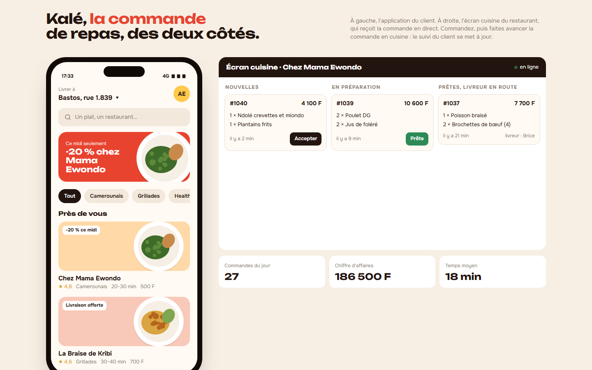
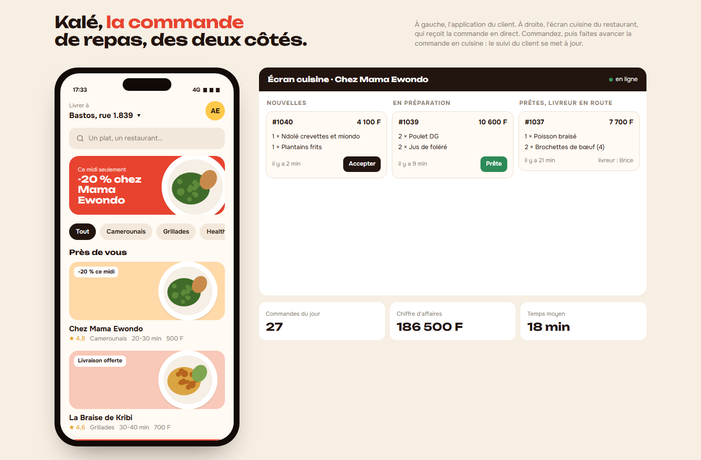
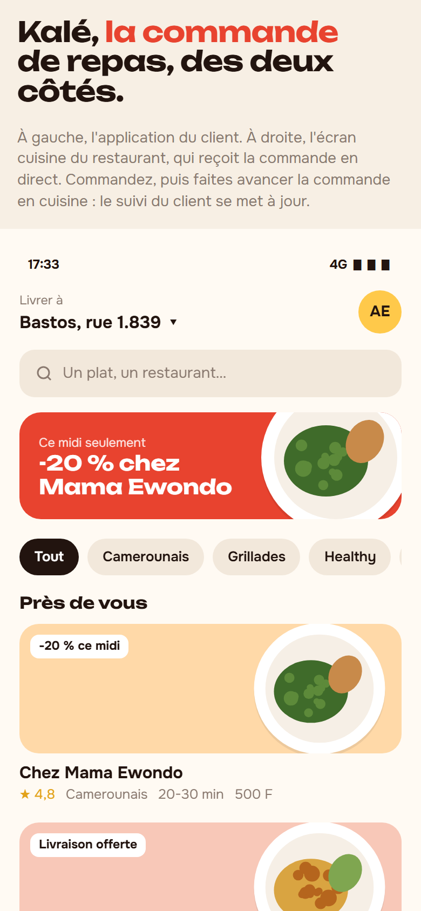

# Kalé

**Application de commande et livraison de repas** — Application mobile de commande de repas, présentée avec l'écran cuisine du restaurant : liste des restaurants proches, menu illustré, panier avec réduction, paiement Orange Money, MTN MoMo ou espèces, puis suivi en direct (préparation, livreur sur la carte, livraison). Le restaurant accepte et prépare la commande depuis son écran, et le suivi du client se met à jour.

**Démo en ligne : [https://lordlennyx.github.io/kale-livraison-repas/](https://lordlennyx.github.io/kale-livraison-repas/)**

Spot de présentation (30 s) : [media/spot-30s.mp4](https://lordlennyx.github.io/kale-livraison-repas/media/spot-30s.mp4)

## Ce que le projet montre

- Accueil : adresse de livraison, recherche, promotion, catégories, restaurants avec note, délai et frais
- Fiche restaurant : menu par rubriques, ajout au panier en un geste, barre de panier flottante
- Panier : quantités, réduction, frais de livraison, choix du paiement mobile
- Suivi : étapes de la commande, carte avec trajet animé du livreur, temps estimé, contact du livreur
- Écran cuisine en temps réel : nouvelles commandes, en préparation, prêtes, chiffre du jour

## Réalisation

- **Stack :** HTML, CSS, JavaScript natif, SVG animé
- **Typographies :** Unbounded, Onest
- **Évolutions possibles :** application native (Flutter, React Native), back-end temps réel (Firebase, Supabase), géolocalisation réelle des livreurs, API Mobile Money

| Bureau | Mobile |
|---|---|
|  |  |

---

Client et contenus fictifs, créés pour la démonstration. Conception, design et développement : **Njundiyimun Béchard** — [github.com/LordLennyx](https://github.com/LordLennyx)
